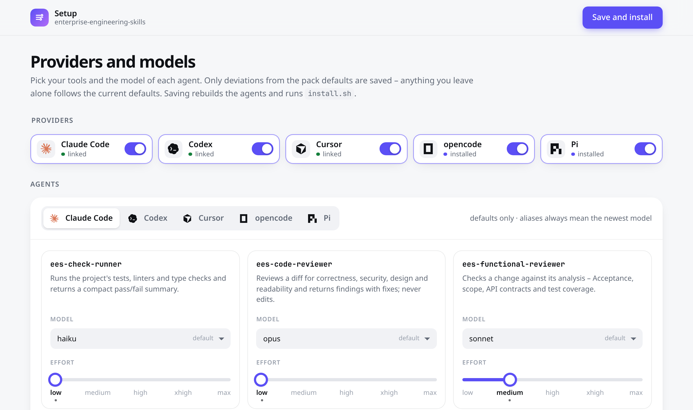
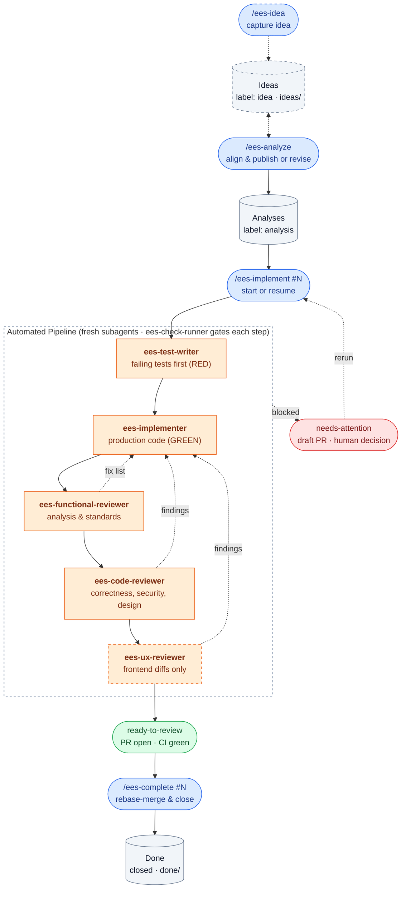

# Enterprise Engineering Skills

[](#supported-providers)
[](#supported-providers)
[](#supported-providers)
[](#supported-providers)
[](#supported-providers)
[](#supported-providers)
<br>
[](#workflow)
[](#configuration)
[](#quick-start)
[](#quick-start)

<picture>
  <source media="(prefers-color-scheme: dark)" srcset="docs/images/setup-dark.png">
  
</picture>

A multi-provider pack of engineering skills and subagents for **Claude Code, Codex, Cursor, opencode, Pi, and Antigravity**. You make the architectural decisions; specialized agents write failing tests, implement the code, run checks, review diffs, and deliver the PR.

Behaviour and boundaries are agreed on first and implemented second, so you always understand what ships. Trivial fixes skip the pipeline.

---

## Workflow

You participate at the decision points. Once you run `/ees-implement #N`, the main session orchestrates a chain of fresh subagents, reviews every handoff, and makes all commits, pushes, and PRs.



**Blue** = you · **Orange** = subagents · **Grey** = tracker (GitHub issues or `docs/agents/analysis/`) · **Dashed** = optional

### Steps

0. **`/ees-idea`** *(optional)* — Note a planned change (Goal, Change, optional `Depends on`) without analyzing code yet.
1. **`/ees-analyze`** — Structured interview to settle design decisions one question at a time, then publish an analysis (current state, change, architecture, API contracts, acceptance criteria, and rejected alternatives in `## Further Notes`).
2. **`/ees-implement #N`** — Runs the automated pipeline: tests committed first (RED), implementation until green, functional review against the analysis, code review, and UX review for frontend diffs. Opens a ready PR when all gates pass, or a draft PR marked `needs-attention` when a human decision is needed.
3. **`/ees-complete #N`** — Verifies CI is green and the PR is approved, then rebase-merges, deletes the branch, closes the issue, and pulls `main`.

### Other Modes

- **Revising an analysis:** Run `/ees-analyze #N` with what changed. Contradictions are surfaced and agreed on first; the analysis is rewritten in place and post-implementation changes are tracked under `## Revisions` so `/ees-implement #N` continues on the same branch.
- **Dependencies:** Add `Depends on: #41, #42` in an idea or analysis. `/ees-implement` refuses to start until all dependencies are closed.
- **Without an analysis:** Ordinary prompts run directly in the main session (optionally followed by `/ees-code-review`). Use `/ees-change` to run the full test → implement → review pipeline from a short brief.
- **Keep commits local:** Say *"don't push"* in the session to skip pushing and PR creation. See [`skills/ees-pipeline/delivery.md`](skills/ees-pipeline/delivery.md) for delivery rules.

---

## Quick Start

```bash
git clone git@github.com:rdurica/enterprise-engineering-skills.git ~/Projects/enterprise-engineering-skills
cd ~/Projects/enterprise-engineering-skills
```

**Option A — Local Setup UI (recommended):**

```bash
make setup
```

Opens a localhost page (protected by a one-time token) to toggle providers, pick models and effort levels per agent, load models available on your machine, and install with live output.

**Option B — CLI Installer:**

```bash
./install.sh                                # interactive provider wizard
./install.sh --providers claude,codex --yes # non-interactive selection
./install.sh --all --dry-run                # preview plan without writing
```

`install.sh` builds `generated/<provider>/agents/` from `agents.toml`, links skills and agents for the selected providers, removes stale pack links for unselected providers, and never touches your own files. Afterwards, `git pull` rebuilds generated agents automatically via `.githooks`; re-run `./install.sh` only when skills or agents are added or removed.

---

## Supported Providers

Each agent is authored once in `agents/<name>.md` with per-provider defaults in [`agents.toml`](agents.toml) and compiled by `scripts/build-agents`.

| Provider | Skills | Agents | Skill invocation |
|----------|--------|--------|------------------|
| **Claude Code** | `~/.claude/skills/` | `~/.claude/agents/` | `/ees-analyze #N` |
| **Codex** | `~/.agents/skills/` | `~/.codex/agents/` | `/ees-analyze #N` |
| **Cursor** | `~/.agents/skills/` | `~/.cursor/agents/` | `/ees-analyze #N` |
| **opencode** | `~/.agents/skills/` | `~/.config/opencode/agents/` | `@ees-analyze #N` |
| **Pi** | `~/.agents/skills/` | `~/.pi/agent/agents/` | `/ees-analyze #N` or `/skill:ees-analyze #N` |
| **Antigravity** | `~/.gemini/config/skills/` | `~/.gemini/config/agents/` | `/ees-analyze #N` |

<details>
<summary>Provider-specific notes (Antigravity, opencode, Pi, Codex)</summary>

- **Antigravity (`agy`):** Agents use model tiers (`inherit`, `flash`, `pro`) rather than concrete model IDs; pick the main session model with `/model`. Subagents run without network access, so package installs, `gh`, and git push stay in the main session.
- **opencode:** `install.sh` merges the pack's model keys into `opencode.json` (backing up the original to `opencode.json.bak`). Requires Claude Code logged in (`claude auth login`) for the `claude-agent` provider. Reads `AGENTS.md`, not `CLAUDE.md`.
- **Pi:** `install.sh` also links the subagent extension into `~/.pi/agent/extensions/subagent/` and generated `/ees-*` prompt aliases into `~/.pi/agent/prompts/`. Thinking level is appended as `:<variant>` on the model string. Reads `AGENTS.md`, not `CLAUDE.md`.
- **Codex:** Does not enforce per-agent tool restrictions; read-only agents rely on their instructions.

</details>

---

## Agents

Subagents never commit, push, or open PRs — the main session owns git and delivery. Tests are always committed before production code, and assertions are never weakened to make code pass.

| Agent | Access | Role |
|-------|--------|------|
| `ees-test-writer` | read-write | Writes tests for one slice and verifies RED before implementation |
| `ees-implementer` | read-write | Writes production code against committed tests and fixes review findings |
| `ees-functional-reviewer` | read-only | Checks acceptance criteria, scope, API contracts, coverage, and project standards |
| `ees-code-reviewer` | read-only | Reviews correctness, security, design, performance, tests, and readability |
| `ees-ux-reviewer` | read-only | Audits frontend diffs for design-system consistency, WCAG 2.2 AA, and usability |
| `ees-check-runner` | read-only | Runs tests, linters, and type checks; returns only failure excerpts |

How the pipeline controls cost — compact summaries, tiered checks, delta reviews, and escalation — is documented in [`skills/ees-pipeline/execution.md`](skills/ees-pipeline/execution.md).

---

## Skills

| Group | Skills |
|-------|--------|
| **Pipeline** | `/ees-idea`, `/ees-analyze`, `/ees-implement`, `/ees-complete` *(internal steps: `ees-verify`, `ees-ux-review`, `ees-pipeline`)* |
| **Ad-hoc & Review** | `/ees-change`, `/ees-code-review`, `/ees-discuss` |
| **Git & Repo** | `/ees-commit`, `/ees-git-release`, `/ees-monorepo-update`, `/ees-setup` |
| **Testing Playbooks** | `ees-tdd`, `ees-integration-tests` *(loaded by `ees-test-writer`)* |

---

## Configuration

Projects work out of the box with zero configuration — tracker, monorepo roots, and conversation language are auto-detected.

### Provider & Model Overrides

`make setup` writes only your deviations from `agents.toml` to `${XDG_CONFIG_HOME:-~/.config}/enterprise-engineering-skills/settings.json`, so `git pull` continues to update untouched defaults:

```json
{
  "providers": ["claude", "antigravity"],
  "agents": { "ees-code-reviewer": { "claude": { "model": "opus", "effort": "medium" } } }
}
```

### Workflow Settings

Optional settings live in `~/.config/enterprise-engineering-skills/workflow.md` (global) or `docs/agents/config/workflow.md` (project), or can be configured via `/ees-setup`. Precedence: **session → project → global → auto-detect**.

| Key | Default | Options |
|-----|---------|---------|
| `language` | conversation / analysis language | `en` · `cs` |
| `tracker` | auto-detected | `github` · `local` *(project file only)* |
| `## Monorepo` | auto-detected | delivery root mapping *(project file only)* |

Project-specific review rules can be placed in `docs/agents/config/{verify,code-review,ux-review}.md`. Personal, gitignored skills go in `skills/personal/`. See [`skills/ees-pipeline/config.md`](skills/ees-pipeline/config.md) for the full format.

### Tracker Status

With the **local tracker**, ideas live in `docs/agents/analysis/ideas/`, active analyses in `docs/agents/analysis/`, and completed ones move to `done/`. With **GitHub**, issues use these labels:

| Label | Meaning |
|-------|---------|
| `idea` | Captured idea; `/ees-analyze #N` converts it to `analysis` |
| `in-progress` | `/ees-implement` is running or paused; rerun to resume |
| `needs-attention` | Blocker requires your decision; resolve and rerun `/ees-implement` |
| `ready-to-review` | All gates passed; review the PR and run `/ees-complete` |

<details>
<summary>Optional: Cross-tool agents with Herdr</summary>

Inside a single provider, agents run natively as subagents. If you want a session in one tool (e.g. Codex) to delegate a role (e.g. code review) to another tool (e.g. Claude Code), you can wire it via [Herdr](https://herdr.dev) (`hc`):

1. Add a template in `~/.config/herdr-core/templates/claude-code-reviewer.md` with `command: claude --agent ees-code-reviewer`.
2. Start it from a Herdr terminal:
   ```sh
   hc run --bg --name review --cwd "$PWD" claude-code-reviewer "Review git diff main...HEAD. Read-only."
   hc wait review
   ```
3. Optionally add a routing rule in your personal `AGENTS.md` / `CLAUDE.md` when `$HC_TERMINAL_ID` is set.

</details>
