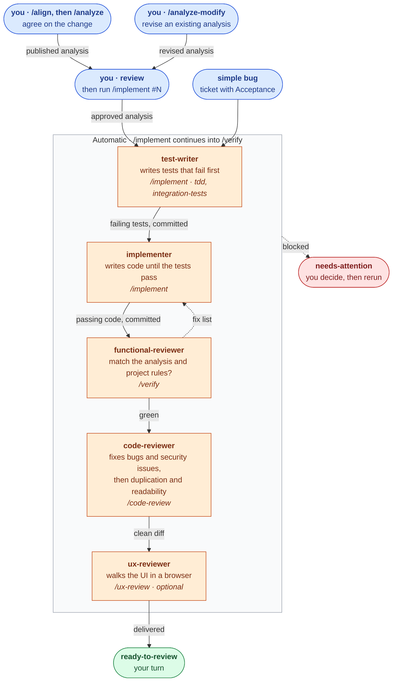

# Enterprise Engineering Skills

Claude Code skills and agents for changes in an existing codebase. You make the decisions; agents write the tests and code, review them and deliver the result.

The goal is not just working code. Whoever owns the project should understand the change well enough to explain it, so behaviour and boundaries are agreed first and implemented second. Trivial fixes skip the pipeline.

## Quick start

```bash
git clone git@github.com:rdurica/enterprise-engineering-skills.git ~/Projects/enterprise-engineering-skills
~/Projects/enterprise-engineering-skills/install.sh
```

`install.sh` links every skill into `~/.claude/skills/` and every agent into `~/.claude/agents/`. It never overwrites a different skill with the same name, removes dangling links into the pack left by deleted skills or agents, and `--dry-run` shows the plan. Afterwards `git pull` is enough; re-run the script only when a skill or agent is added, renamed or removed.

Then run `/setup` once in each target project.

## Workflow

You take part in only three steps. Everything after `/implement #N` is a chain of agents: each one gets a fresh context, finishes one job and hands its result to the next. The main session (Opus) sits between them, reviews every handoff and makes the commits.



**Blue** = you · **orange** = agents · *italics* = the skill that runs the agent. Every step runs tests, lint and type checks through `check-runner`, which returns only the failures.

1. **`/align`** — you and Claude explore the code and settle decisions one question at a time. Lasting trade-offs become ADRs.
2. **`/analyze`** — Claude turns the decisions into an analysis in the same conversation: current state, change, architecture, API contracts and Acceptance.
3. **You review it** and run **`/implement #N`** (or a local analysis path). From here it runs on its own:
   - `test-writer` writes tests for each slice of the change and proves they fail; they are committed before any code.
   - `implementer` writes code against those tests until they pass.
   - `functional-reviewer` checks the result against the analysis and project rules; anything missing goes back to `implementer`.
   - `code-reviewer` reviews and fixes the code, correctness first, then craft. Its first cycle covers the whole diff; repair cycles check only what changed since; `ux-reviewer` walks the UI if UX review is enabled.
   - The result is delivered as `ready-to-review`, or stops as `needs-attention` when a decision is yours.

A **simple bug** skips steps 1–2: a ticket with Acceptance goes straight to `/implement`.

To **change an existing analysis** — before `/implement`, or after it when a change request arrives — run **`/analyze-modify #N`** with what should be different. Claude checks the analysis, ADRs and any committed code for what the change contradicts, names the risks and agrees each one with you, then rewrites the analysis in place so it reads as one consistent state. Changed Acceptance items are unchecked, `## Revisions` at the end records the modification, and `/implement #N` continues on the same branch with only the unchecked items.

## Agents

| Agent | Used by | What it does | Model |
|-------|---------|--------------|-------|
| `test-writer` | `/implement` | Writes tests for one slice of the change and proves they fail | Sonnet, medium |
| `implementer` | `/implement`, repairs | Writes production code against the committed tests | Sonnet, medium |
| `functional-reviewer` | `/verify` | Checks Acceptance, scope, API contracts, test coverage and documented project rules (read-only) | Sonnet, high |
| `code-reviewer` | `/code-review` | Fixes bugs and security issues, then leftovers, duplication and readability | Sonnet, medium |
| `ux-reviewer` | `/ux-review` | Walks the affected screens in a browser; checks accessibility | Sonnet, medium |
| `check-runner` | all pipeline skills | Runs tests, lint and type checks; returns only failures | Haiku, low |

`/align`, `/analyze`, `/analyze-modify` and `/commit` set no model or effort: they are your conversation, so they use whatever you have selected. The pipeline skills (`/implement`, `/verify`, `/code-review`, `/ux-review`) run on **Opus, medium** and only plan, review and commit. `/setup` runs on Sonnet high, `/git-release` and `/monorepo-update` on Sonnet medium.

- **Cheap models live in agents, not in the main session.** Switching models mid-conversation throws away the prompt cache, so the main session stays on Opus.
- **Logs stay out of Opus.** Test and lint output goes through `check-runner`, which returns only the failures.
- **Opus reads summaries.** The main session reviews worker reports and `git diff --stat`, and opens full diffs only where something looks wrong.
- **Full review once, deltas after.** Repair cycles review only what changed since the previous cycle; the first code-review cycle covers the whole diff.
- **Checks in tiers.** Repairs run only the affected tests; the full suite runs at the start of `/verify` and before Ship.
- **Escalate on evidence.** A cluster that fails twice is retried with higher effort, then on Opus; a code-review cycle that missed an issue is rerun at high effort.

Change a role by editing `model` or `effort` in its frontmatter. `CLAUDE_CODE_EFFORT_LEVEL` overrides every `effort`.

Agents never commit, push or open PRs; the main session does. Tests are committed before the code, and assertions are never weakened to make code pass.

## Status

With the local tracker there is no status: an analysis in `docs/agents/analysis/` is active, and a green `/verify` moves it to `done/`. Blockers are noted under `## Comments`. On GitHub, the issue carries these labels:

| Label | Meaning |
|-------|---------|
| `in-progress` | `/implement` is running or was interrupted; rerun it to resume |
| `needs-attention` | A blocker needs your decision; resolve it and rerun `/implement` |
| `ready-to-review` | All gates passed; your turn to review |

Notes go on the analysis, never on the PR.

## Configuration

`/setup` writes `docs/agents/config/` and an `## Agent skills` block in `AGENTS.md`. Re-run it any time to change settings.

| Setting | Options |
|---------|---------|
| Preset | `full-agentic` (agent manages branch and PR) · `human-owned` (stays on your branch, PRs are yours) |
| Push | `finalize` (push and watch CI) · `never` (local commits only) |
| Tracker | GitHub issues · local Markdown in `docs/agents/analysis/` |
| Language | `en` · `cs` for analysis prose and comments |
| UX review | enabled · disabled |

Skills and agents are used only from the global install in `~/.claude/`; `/setup` offers to remove pipeline copies left in a project by older setups. Project-specific rules go in `docs/agents/config/`. Local-only skills go in the gitignored `skills/personal/`.

## Other skills

- **`/commit`** — Conventional Commits from the diff; `/commit push` also pushes.
- **`/git-release`** — semver tag and GitHub release with a changelog.
- **`/monorepo-update`** — bump submodules or check out an analysis branch in every delivery root.
- **`tdd`**, **`integration-tests`** — testing playbooks used by `test-writer`.
