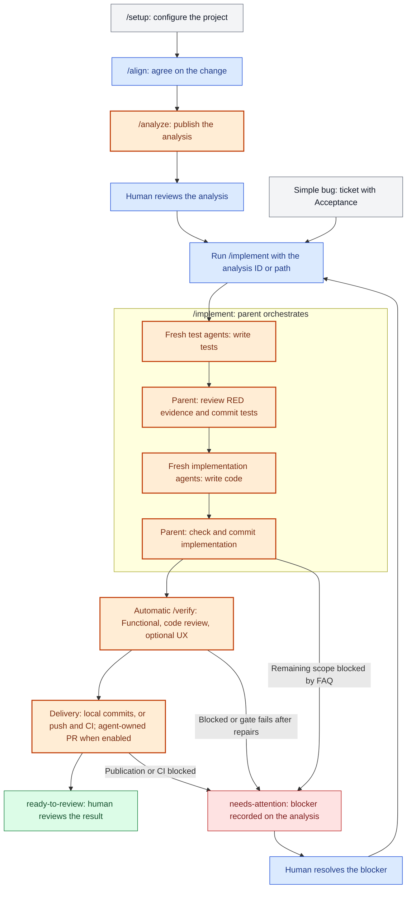

# Enterprise Engineering Skills

Claude Code skills and subagents for incremental changes in an existing codebase. You own the decisions and contracts; agents write tests, implement the change and verify the result. Delivery is verified local work or an agent-managed PR, depending on the project configuration.

## Why

Working code is only part of the goal. Whoever owns the project must understand the change and be able to explain it. This workflow puts that understanding first: agree on the behaviour, architecture and boundaries, then let agents handle implementation inside them.

Built for repositories with tests and documented conventions, especially changes that cross modules or need review by someone other than the author. Trivial fixes can go directly through the project's normal workflow.

## Process

Run `/setup` once in the target project, then:

1. **`/align`** — explore the code and resolve decisions together. Record durable trade-offs in ADRs.
2. **`/analyze`** — publish the agreed change and its Acceptance criteria. Current State and Change each explain the behaviour in 2–4 short sentences; implementation details belong in Architecture and API Contracts. Mermaid diagrams highlight affected parts in orange.
3. **Review the analysis**, then run **`/implement #N`** or pass a local analysis path.
4. **`/implement` orchestrates the work** — fresh `test-writer` agents write tests; the parent reviews RED evidence and commits the tests. Fresh `implementer` agents then write production code; the parent checks and commits it.
5. **`/verify` runs automatically** — Functional checks, code review, optional UX review, then delivery according to branch ownership and push policy. You review the result.



Blue = human decisions and invocation; orange = agent work; green = ready for review; red = needs attention.

For a **complex bug**, use the same flow, with `/align` when the root cause is unclear and `Kind: bug` in the analysis. A **simple bug** starts with a ticket containing Acceptance and goes straight to `/implement`. You can also invoke `/verify` directly for work with an existing analysis.

## Tracking and resume

Publishing an analysis does not start implementation. On GitHub it has the `analysis` label; a new local analysis has no Status line. User-invoked `/implement` needs no `ready-for-agent` label; that label is only for optional auto-start.

- **`in-progress`** — implementation is running. An interrupted session stays here; re-run `/implement` to resume from the analysis and git state.
- **`needs-attention`** — a blocker requires a decision or fix. It replaces `in-progress`. Resolve the reported blocker and re-run `/implement`. An open FAQ permits work on decided scope, but unfinished scope cannot be verified as complete.
- **`ready-to-review`** — all applicable gates passed. Local analyses move to `docs/agents/analysis/done/`; GitHub analyses receive the label. This records verified delivery, not a merge or human approval.

Progress and verification notes go on the analysis, never on the PR. The final note distinguishes local checks, publication and CI, including anything skipped.

## Configuration

`/setup` writes `docs/agents/config/workflow.md`, tracker configuration and domain documentation, and updates the Agent skills block in `AGENTS.md`. On every run, you choose whether to use global skills or copy the pipeline into the project; the saved choice is preselected.

Agent files share `docs/agents/`: configuration and project-specific instruction overlays live in `config/`, active local analyses in `analysis/`, and completed analyses in `analysis/done/`. Workflow `local-path` points to `docs/agents/config/`, not the analysis directory. Setup preserves analyses when refreshing configuration. Projects choose whether to version these files; setup does not automatically ignore, stage or commit them.

Choose **full-agentic** for agent-managed branches and PRs, **human-owned** to stay on your current branch and manage PRs yourself, or **custom** to select settings individually. Both presets default to GitHub and `push: finalize`; human-owned can use the local tracker.

- **Branch ownership:** `agent` uses the analysis Delivery branch and manages PRs; `human` stays on the current branch and leaves PRs to you.
- **Push policy:** `finalize` permits push and CI during delivery; `never` keeps local commits and skips push, CI watches and PR changes. Session instructions such as “do not push” override the defaults.
- **Tracker:** GitHub or Local Markdown in `docs/agents/analysis/`. Setup can keep reference configurations for both, with one active backend.
- **Language:** `en` or `cs` for analysis prose and tracker comments; section headings remain English.
- **UX review:** optional browser gate after code review; skipped for changes without UI.
- **Skills mode:** `global` uses the shared pack installed in `~/.claude/`; `vendored` copies the pipeline skills and agents into `.claude/skills/` and `.claude/agents/` and refreshes them on every `/setup`. New projects default to the global recommendation; existing configuration with only `skills-dir` defaults to project copies.

Agent-owned delivery produces a ready PR after green checks, or may retain a draft PR on failure when publication is allowed. Human-owned delivery never manages PRs. In monorepos, analyses live at the container root and implementation happens in delivery roots; submodule pointer updates remain a human step.

## Skills and agents

The repository holds two folders: `skills/` (one folder per skill) and `agents/` (one Claude Code subagent per file). The project pipeline is `/align` → `/analyze` → `/implement`, with `/verify` called automatically. Its helpers are `tdd`, `integration-tests` for Symfony HTTP tests, `commit`, `code-review` and `ux-review`. In vendored mode, `/setup` copies those nine skills and all nine agents; in global mode, they stay in the shared pack. `setup`, `git-release` and `monorepo-update` always remain in the shared pack.

The parent session schedules work, reviews results, commits and handles delivery. Workers are named agents with fresh contexts, scoped Acceptance, architecture, contracts and allowed paths. They never commit, push or manage PRs. Parallel work requires disjoint write paths and isolated mutable resources.

Tests are committed before production implementation. Later test corrections need a concrete reason, parent review and a separate test commit; assertions must not be weakened to make faulty code pass. Verify fixes actionable findings within scope and stops on blockers or exhausted repair limits.

## Models and cost

Every skill and agent sets `model` and `effort` in its frontmatter. The expensive model decides; cheaper models do bounded, well-specified work in fresh contexts.

| Where | Runs on | Effort | Why |
|-------|---------|--------|-----|
| `/align`, `/analyze`, `/implement`, `/verify`, `/code-review`, `/ux-review` (main session) | Opus | medium | Interview, planning, review of worker output, commits |
| `analyst` agent | Sonnet | high | Drafts the analysis from the align decisions; Opus reviews and publishes |
| `test-writer` agent | Sonnet | medium | Tests from a written contract, with `tdd` and `integration-tests` preloaded |
| `implementer` agent | Sonnet | medium | Code against committed tests; also delegated repairs |
| `spec-reviewer` agent | Sonnet | high | Read-only check of the diff against the analysis |
| `standards-reviewer` agent | Sonnet | medium | Read-only check against documented rules |
| `correctness-reviewer` agent | Sonnet | high | Fix-first correctness and security pass |
| `craft-reviewer` agent | Sonnet | medium | Fix-first readability, duplication and test-quality pass |
| `ux-reviewer` agent | Sonnet | medium | Browser walkthrough or a11y pass |
| `check-runner` agent | Haiku | low | Runs tests, linters and type checks; returns a compact summary instead of full logs |
| `/setup` | Sonnet | high | Configuration interview; usually its own session |
| `/git-release`, `/monorepo-update` | Sonnet | medium | Mechanical git and GitHub work with an approval step |
| `commit`, `tdd`, `integration-tests` | inherit | — | Run inside another skill or agent |

Three rules keep the savings real:

- **Cheap models live in agents, not in the main session.** A skill's `model` switches the main conversation for the rest of the turn, and prompt caches are per model, so a mid-conversation switch re-reads the whole history uncached. That is why `commit` inherits the model and `/analyze` delegates drafting to `analyst` instead of switching itself to Sonnet.
- **Logs stay out of Opus.** Long test and lint output goes through `check-runner`.
- **Escalate on evidence.** `/implement` retries a failing cluster with `effort: high`, then with Opus, never on the first attempt.

Tune a role by editing its frontmatter. Aliases (`opus`, `sonnet`, `haiku`) follow the newest model in each family; pin a full ID such as `claude-sonnet-5-5` when you need reproducible runs. The `CLAUDE_CODE_EFFORT_LEVEL` environment variable overrides the `effort` values.

## Installation

Clone once, anywhere, then link both folders into Claude Code:

```bash
git clone git@github.com:rdurica/enterprise-engineering-skills.git ~/src/enterprise-engineering-skills
~/src/enterprise-engineering-skills/install.sh
```

`install.sh` creates one symlink per skill in `~/.claude/skills/` and one per agent in `~/.claude/agents/`. It reuses correct links, relinks links into this pack or dangling ones, and skips anything else that already uses the same name. `--dry-run` shows the plan. After that, `git pull` updates everything; re-run `install.sh` only when a skill or agent is added or renamed. Check `/skills` and `/agents` in a new session.

Run `/setup` inside the target project and choose global skills or project copies. Project copies go to `.claude/skills/` and `.claude/agents/` by default; project definitions take precedence over global ones with the same name.

Re-run `/setup` to refresh project configuration and review the skills mode. In vendored mode, every pipeline skill and agent is refreshed from the maintained shared pack. In global mode, `/setup` leaves that pack unchanged; update it with `git pull`. When switching to global skills, setup offers to remove existing project copies with separate confirmation; if retained, it warns that they shadow the global pack. Keep project-specific additions in `docs/agents/config/`, because refresh replaces vendored copies. A gitignored `skills/personal/` folder holds local-only skills; `install.sh` links them too.
