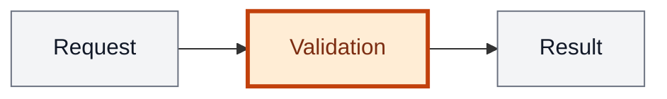

# Analysis template

Writing rules and section template for `/analyze`. Delivery and publishing follow [SKILL.md](SKILL.md).

## Writing style

Keep the analysis easy to scan. Current State and Change each use one paragraph of 2–4 short sentences in plain language. Explain behaviour and user impact there; keep class names, paths, data shapes and implementation steps in Architecture or API Contracts. Avoid repeating the same information across sections.

- Backticks are for paths, commands, HTTP routes and literal values. Class, command, DTO and event names in prose stay plain text.
- Put data shapes in fenced blueprint blocks.
- Frontend stays short when it is involved; it is not the focus.
- `## Affected Areas` is a short bullet map of where the change lands, not a second Architecture. It always includes a Mermaid diagram of the behaviour.
- `## API Contracts` is omitted when there is no API.

### Mermaid highlighting

Every diagram must highlight the processes, nodes or regions being changed or added in orange; keep surrounding context neutral. Highlight only parts affected by this change, including in current-state diagrams. Add a short legend below each diagram in the analysis language: “Orange = changed or new part.”

For flowcharts, use the shared `changed` class with an orange fill and a strong border:



Orange = changed or new part.

For other Mermaid types, use their supported styling to highlight the affected region in orange. If the type cannot highlight the affected part, use a flowchart instead.

### Architecture subsections

Each `###` names one real project unit: a package, repo, module or bounded context, never a layer such as Controller or Repository or an invented unit. Use only the unit name in the heading; put `Path: <path>` on the first line below it. Omit subsections for a single-unit change.

Name shared seams between units so `/implement` can safely parallelize disjoint paths. When the change relies on a decision from an earlier analysis, link that analysis from Architecture. Decisions from the interview belong in Further Notes.

## Template

<analysis-template>

## Current State

{2–4 short sentences: how the relevant behaviour works today and what problem
or limitation motivates the change. No technical inventory or extra bullets.}

## Change

{2–4 short sentences: how that behaviour will work after the change and what
the user will experience differently. Keep technical details in Architecture.}

## Affected Areas

{a high-level map of where the change lands: one bullet per area — module,
service, app or screen — with a few words on what changes there. Use the same
names as the Architecture units. No classes, paths or data shapes; those stay
in Architecture. Below the bullets, a Mermaid of the behaviour across these
areas, affected parts in orange, with a legend — always, even for a bug.

Example:
- Billing — new plan-change rule with proration
- Groups API — endpoint for the owner to change the plan
- Admin UI — plan picker on the group detail page}

## FAQ

{optional. Unresolved questions as bullets, each naming what it belongs to —
a section or a contract. Publishing with an open FAQ is fine. After answers:
fold each one into the right section and delete the item.}

## Architecture

{layers, data flow, decisions carried over from earlier analyses.
One `###` per real unit, path on the line below the heading.
When the schema changes, state the delta — tables and columns added or
changed, nullability, defaults, indexes — plus the migration, written by
hand, with the backfill and the rollback whenever existing rows are touched.}

## API Contracts

{one block per endpoint; omit the whole section when there is no API.
Authorization is mandatory in every block — who may call it, and the status
and error code everyone else gets.}

```
POST /api/groups/{uuid}/plan

Authorization
- group owner only; any other member 403 insufficient_permissions

Request
- string: planCode
- bool: prorate

Response 200
- string: planCode
- string: effectiveFrom (ISO-8601)

Errors
- 409 plan_downgrade_blocked
- 404 group_not_found
```

## Acceptance

{`- [ ]` list: one observable behaviour and one seam per item, with a concrete
input or trigger and expected result. Cover happy, error and boundary paths.
Each API endpoint needs a denied-caller item with its authorization status
and error code. Reference API contracts instead of repeating payloads.
Keep items separate for TDD clustering and verify; no implementation tasks
or test-writing checkboxes.

Example: - [ ] POST /orders with an out-of-stock item → 409, body `code: out_of_stock`, no order row}

## Further Notes

{the only record of decisions: one bullet for each decision the interview
settled, including the rejected alternative. Add other bullets only for impact, risks or rollout
and migration steps. No repetition or statements about unchanged behaviour.
Omit when empty.}

## Revisions

{only after `/analyze-modify`; always the last section. One bullet per
modification, oldest first: date, the modification in one sentence, the risks
the user accepted, and — when tests are already committed — the tests that
must change. The body above stays a single current state; history lives here.}

</analysis-template>

**Bug:** Current State, Change, Affected Areas, Acceptance. Architecture and API Contracts only when they apply; FAQ and Revisions optional, in the same positions.
